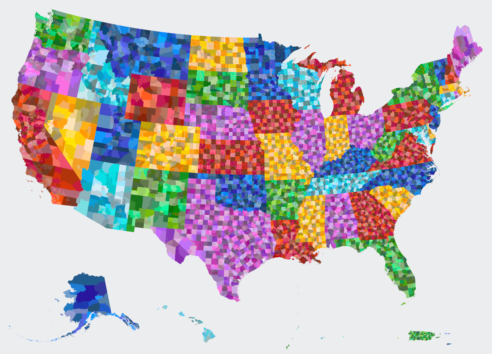

# Nested political map

**[Open the map](https://zmm2025.github.io/nested-political-map/)**

One fixed picture of the United States with no outlines. From far away it looks like a political map of states. Closer, each state turns out to be counties in different shades. Closer still, each county turns out to be towns. No color ever changes. Only the viewing distance does.



## How the colors work

- **States** get one of six hue families, assigned so that neighbors are far apart in OKLab, including under simulated red-green color blindness.
- **Counties** are spread out inside their state's family so that neighbors contrast.
- **County subdivisions** (towns, townships, census county divisions) are spread out in a small ball around their county's color.
- **Averages are held fixed.** The area-weighted mean of the children, taken in linear light, equals the parent's color. When the children are too small to see, the parent's color is what remains.

| Neighbors | Pairs | Closest pair (OKLab × 100) | Median |
| --- | ---: | ---: | ---: |
| States and territories | 115 | 15.4 | 25.9 |
| Counties in one state | 7,776 | 8.1 | 14.2 |
| Subdivisions in one county | 63,232 | 2.7 | 6.5 |

Cities are not a level because they do not nest: 1,110 of 19,558 incorporated places in the Census Bureau's 2020 list cross a county line. County subdivisions do nest.

## Files

- [docs/](docs) is the site: plain HTML, CSS and JavaScript with no build step of its own.
- [docs/map.bin](docs/map.bin) is the gzipped geometry, colors and names.
- [docs/img/us-nested-map.png](docs/img/us-nested-map.png) is the 9600 × 6912 picture.
- [build/](build) makes both from the Census downloads: [prep.py](build/prep.py) projects, [graph.py](build/graph.py) finds neighbors, [colors.py](build/colors.py) solves the colors, [pack.py](build/pack.py) and [images.py](build/images.py) write the output.

## How it is drawn

Phones close tabs that are greedy with graphics memory, so the viewer keeps memory small and steady: the averaged picture from far away, one light mesh in the middle, and full detail only for the states on screen, up to a fixed budget. Nothing is allocated while a gesture is running. If WebGL is missing or taken away, the still picture takes over.

## Rebuild

Needs Node, Python 3, bash, curl and unzip. Takes about five minutes.

```sh
npm install
pip install -r build/requirements.txt
npm run build
```

## Sources

Borders: U.S. Census Bureau 2025 cartographic boundary files, 1:500,000 (public domain). Triangulation: [earcut](https://github.com/mapbox/earcut) (ISC). Type: [Overpass](https://overpassfont.org) (OFL).
